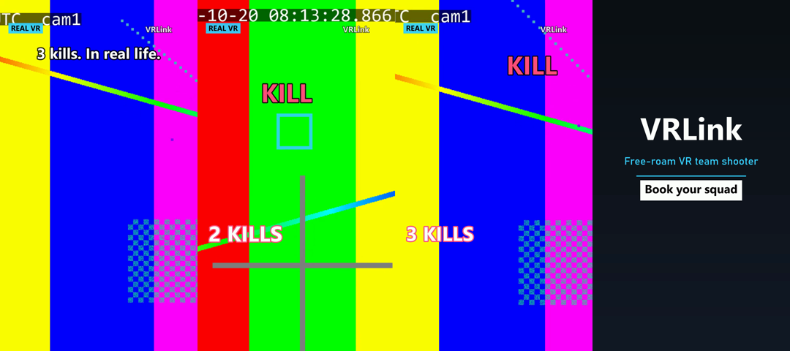
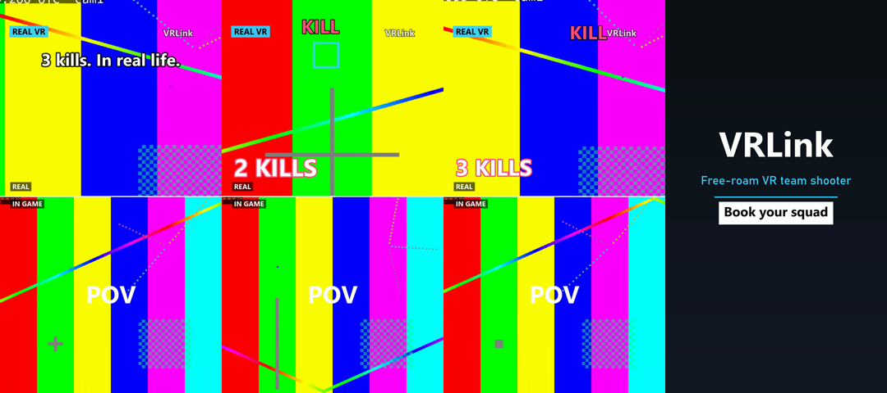
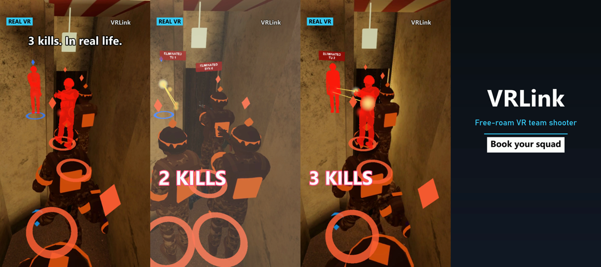
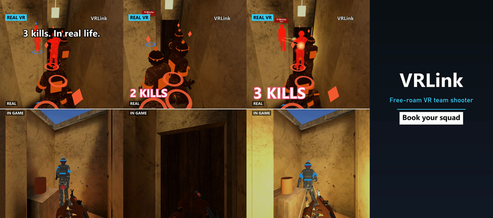

# V2: IRL + overlay composer and "Split reality"

Turns a detected highlight into vertical clips made from **real arena-camera footage with the game drawn on top**:

- `<id>-irl`: 1080×1920 auto-reframed footage + game overlay.
- `<id>-split`: top 1080×960 footage + overlay, bottom 1080×960 the hero's in-game POV. Only for Ace / Kills4 / Kills3 / Clutch.

Both land in `Builds/Highlights/clips/<date>/` in the existing clip contract, so the Publisher imports them like any clip.
**Every clip still needs Clemens' APPROVE click**; the approval rule is unchanged.

Preview frames from the end-to-end test (TEST camera source + fake layers):

| IRL | Split |
|---|---|
|  |  |

The four frames of each sheet are: cold open with the hook, build-up (kill counter, kill banner from the overlay), final kill slow-mo, end card.

## Where it runs
- `src/Composer` is the library: EDL, reframe, compositor, audio, text, layers, the job and the worker.
- `src/Composer.Cli` is `vrlink-compose`, for manual runs.
- The worker is hosted **inside the Capture service** (one Windows service, `VRLinkCapture`). Switch it on with `"Composer": { "Enabled": true }` in `src/Capture/appsettings.json`.
  - It is off by default until the Unity `-renderlayers` mode exists.
  - Status: `GET http://localhost:5090/api/composer` returns the gate reason and the job states.
- All heavy work runs at BelowNormal priority as separate processes (the Unity layer renderer, ffmpeg). The C# frame compositor runs inside the service process.
  - Each process is in a kill-on-close job.
  - Nothing touches the game, headsets or the NetBuildId.

## Inputs
| Input | Where |
|---|---|
| Highlights | `Builds/Highlights/highlights_*.jsonl` (read-only; complete lines only) |
| Demo (v3, UTC) | `Builds/Highlights/demos/**/<matchId>_rNN.vrdemo` |
| Server state | `Builds/Highlights/server_state.json` `{utcNow, phase, connectedClients, matchRunning}` |
| Calibration | `C:\ProgramData\VRLinkPublisher\arena-camera\<venueId>\<cam>.json` (Publisher → Arena camera) |
| Footage | Capture service: window cut with the clap offset applied (in-process, or `GET /api/footage` from the CLI) |
| Layers | Unity `VRCsGoServer.exe -renderlayers …` (or the fake generator) |

**Gate (`ServerGate`).** Compose only when one of these holds:
- the phase is `PostMatch` or `Lobby` and no match is running;
- the phase is `Boot` with 0 clients.

A missing file, or one older than 60 s, means the state is unknown, and the job waits. The CLI can override this with `--force` for manual runs.

**Pins.**
- When a highlight line appears, its footage is pinned at once: [createdUtc − 4 min, createdUtc + 30 s]. The pin outlives the 15-minute retention.
- The pin is released after compose, or after the last failed attempt (3).

**Fallback.** In each of these cases the worker does nothing, and the Unity game-only clip stays:
- no v3 demo (no UTC anchor);
- no calibration for the demo's venue;
- no complete footage for the window.

## Unity layer renderer (built in parallel)
```
VRCsGoServer.exe -renderlayers <demo> <highlightId> -cam <calib.json> -utcfrom <ISO> -utcto <ISO> -fps <fps> -out <dir> [-scale s] [-fakefootage] -logFile <f>
exit 0 ok, 2/3 error
```
- `<calib.json>` is our `CameraCalibration` json (`VRLink.Shared.Calibration`):
  - `Pose {X,Y,Z,Pitch,Yaw,Roll,VFovDeg,K1,Width,Height}`;
  - Unity arena space, Euler Z→X→Y, pinhole + k1;
  - `TimeOffsetMs` is informational only: footage times are already corrected by the Capture service.
- The window is the first kill − 8 s (but not before the round start) to the last kill + 5 s.
- The output folder contains:
  - `overlay.mkv`: FFV1, bgra straight alpha, camera res × scale, frame 0 = utcfrom;
  - `pov.mp4`: 1080×960;
  - `game.wav`: 48 kHz stereo;
  - `layers.json`: `{v, highlightId, utcStart, fps, width, height, frames, hero, heroTrack[{x,y,depth,visible}], moments[{utc,kind,victimLabel,x,y,headshot,oneTap}], players[]}`.
- `heroTrack` is in OVERLAY pixels, one entry per overlay frame.
- `FakeLayerRenderer` writes the same contract with ffmpeg lavfi; tests and `vrlink-compose fake-layers` use it.

## The edit (EDL, `Edl.cs`, pure + unit-tested)
The same EDL drives footage, overlay, POV, room audio and game audio, so they stay in sync.
1. **Cold open:** the decisive (last) kill, 1.0 s of output at 0.5x.
2. **Rewind:** 0.25 s at 4x in reverse. The audio is a whoosh, and a flash follows.
3. **Build-up:** starts 2 s before the first kill.
4. **Per kill:**
   - a 3-frame freeze;
   - a 60 ms white flash;
   - a 6 % zoom punch that eases out over 0.6 s;
   - the kill counter pops.
5. **Gaps > 3 s between kills:** 0.5 s at 1x, a 2x ramp, 3x, a 2x ramp, then 1 s at 1x before the next kill.
6. **Final kill:** 1.2 s at 0.4x, with the freeze inside, followed by a short tail.
7. **End card:** 1.2 s. It shows "VRLink", "Free-roam VR team shooter" and "Book your squad", is static and loops cleanly.

Simultaneous kills within 150 ms count as one freeze, and the counter jumps by n. The target length is **12–20 s**. If the clip comes out shorter, the lead-in and tail grow; if longer, the gaps get faster (4–8x). If even that is not enough footage, a "short" note is logged.

## Reframe (`Reframe.cs`, pure + unit-tested)
- The crop is the largest 9:16 window that fits the source (9:8 for the split top).
- The hero's head sits at about 40 % of the crop height (upper-middle third).
- A dead zone of 6 % of the crop size ignores small moves.
- Pan and zoom follow critically damped springs (ω = 4 rad/s). The pan speed is capped at 1.5 crop widths per second.
- **Push-in:** up to 1.35x toward each kill, fully in 0.3 s before it, held 0.8 s, then relaxing.
- **Upscale limit:** the output never enlarges source pixels more than 1.5x. If that limit would be hit, the push-in is reduced or switched off and a warning is logged.
  - A 1080p camera at full 9:16 height already needs 1.78x, so push-in is off.
  - A 4K camera allows the full 1.35x.
- **Hero not visible:** the crop holds the last position and widens back to 1x after 0.5 s.
- The crop is always clamped inside the image.

## Picture, text and audio
- **Compositor** (C#, `Compositor.cs`):
  - bilinear crop and scale of the footage;
  - the overlay is blended with the same mapping (straight alpha), then flash and punch are applied;
  - split layout: footage on top, POV at the bottom, a 6 px divider;
  - the cold open (where source time goes backwards) is rendered into memory first; the rest streams frame by frame.
  - About 23 s for both formats of a 12 s clip on the server PC.
- **Text** (ffmpeg drawtext, `TextPlan.cs`):
  - hook in the first 1.5 s (template per type, e.g. "1 vs 3. In real life.");
  - kinetic kill counter;
  - "REAL VR" badge and "VRLink" watermark;
  - "REAL" / "IN GAME" labels on split clips;
  - end card.
  - Everything sits inside the TikTok/Reels safe area: top 140, bottom 480, right 140 and left 60 px clear.
- **Fonts:** currently Windows' Segoe UI Bold and Bahnschrift at runtime, configurable via `Composer:FontBold` / `FontRegular`. Nothing is committed.
  - Barlow (SIL OFL 1.1, Google Fonts) is the intended brand font, but downloading it needs the owner's OK. Then drop `Barlow-Bold.ttf` / `Barlow-Regular.ttf` into the repo (`assets/fonts/`, with OFL.txt) and set the paths.
- **Audio** (`AudioBuilder.cs`):
  - room audio (camera mic) and game.wav, each cut by the EDL: atempo for speed changes, silence on freezes and the end card, a pink-noise whoosh on the rewind;
  - the game is ducked under loud room peaks (sidechain, ratio 4 above −18 dBFS, about −6 dB);
  - two-pass loudnorm to −14 LUFS / −1 dBTP;
  - AAC 192k.
  - The audio length is set to frames/fps, so it matches the video exactly.
- **Video encode:** H.264 High, CRF 19, 1080×1920, at the camera fps (30), `+faststart`.

## Output contract (new optional fields)
```json
{ "highlightId": "<id>-irl", "type": "Kills3", "format": "irl", "musicFree": true,
  "sources": ["arenaCam:cam1", "overlay", "gameAudio", "roomAudio"],
  "players": [{"label": "TU 1", "team": "TU", "isBot": false, "hero": true}], "video": "<id>-irl.mp4", ... }
```
- `format` is `"irl"`, `"split"` or `"game"`.
- Split clips add `"pov"` to `sources`.
- Caption, hashtags and venue are copied from the Unity game-only clip json when it exists.
- The Publisher stores format, sources, music-free and players (migration `ClipFormatSources`) and shows them on the approval card.

## CLI
```powershell
vrlink-compose gate                                   # ALLOWED / WAIT + reason
vrlink-compose edl --id 4679a779-r02-8                # print the EDL of a real highlight
vrlink-compose compose --id <id> [--capture http://localhost:5090] [--fake-layers | --layers <dir>] [--out <clipsDir>] [--force]
vrlink-compose fake-layers --out <dir> --from <ISO> --to <ISO> --kills <ISO,ISO> [--w 1920 --h 1080 --fps 30 --scale 1]
```

## Proof (end-to-end test `ComposeEndToEndTests`)
TEST camera source at 1080p30 (real ffmpeg recording through the Capture service) + fake layers + synthetic v3 demo + calibration:

| clip | ffprobe | audio vs video | loudness (ebur128) |
|---|---|---|---|
| e2e-r03-1-irl.mp4 | h264 High 1080×1920 30/1, 12.067 s; aac LC 48 kHz | 12.066667 / 12.066667 (0 ms) | I = −13.7 LUFS, TP −6.0 dBFS |
| e2e-r03-1-split.mp4 | same | 0 ms | I = −13.7 LUFS, TP −6.0 dBFS |

The 1080p TEST source triggers the upscale warning, so push-in is off; it works fully with a 4K camera.

## Real Unity layers (integration, 2026-10-20)
The first real `-renderlayers` pack (`Builds/Highlights/layers/4679a779-r02-8`) was composed with its `plate.mp4` (a game render from
the camera pose) standing in for camera footage. The room audio is silent because the plate has none:
```powershell
vrlink-compose compose --id 4679a779-r02-8 --layers C:\vr\VRCsGo\Builds\Highlights\layers\4679a779-r02-8 --footage plate --out <scratch>
```
| clip | ffprobe | loudness |
|---|---|---|
| 4679a779-r02-8-irl.mp4 | H.264 High 1080×1920 30/1 12.000 s; AAC LC 48 kHz 12.000 s | I −14.1 LUFS, peak −5.1 dBFS |
| 4679a779-r02-8-split.mp4 | same | I −14.1 LUFS, peak −5.1 dBFS |

| IRL (cold open, kill 2 flash/punch, final kill, end card) | Split (cold open, mid frame, final kill, end card) |
|---|---|
|  |  |

The EDL came out at 11.985 s (12.000 s as encoded): kills at 4.250, 5.552 and 8.285 s, end card at 10.785 s. Single frames are `v2/real_*.png`.

Contract notes from the real pack (all handled on our side, no Unity change needed):
- `layers.json` has extra fields: `utcEnd`, `clockExact`, `camTimeOffsetMs`, `files`. They are now read as optional. `clockExact:false` (v2 demo) is logged.
- `overlay.mkv` (FFV1) reports no `nb_frames`, so the frame count comes from duration × fps (286 ✓).
- `plate.mp4` has no audio stream. The room audio is silent, and `sources` reports `plate` instead of `arenaCam:cam1` and drops `roomAudio`.
- The pack's window is the highlight's `clipStart..clipEnd` (9.53 s). When the composer calls the renderer itself it requests
  first kill − 8 s … last kill + 5 s, which gives the edit more room (this pack only just reached the 12 s minimum).
- `players[]` contains all 11 round players, not only those in view. That is fine for the share pack, and the hero is flagged.

## Open points
- The Unity `-renderlayers` mode is not available yet. Until it is, the worker stays disabled.
  - First real run: `vrlink-compose compose --id <id> --force` after a session with a calibrated camera.
- The real-camera look (4K) and the speed of the C# compositor at 4K source resolution are not measured yet.
- Barlow font: waiting for the owner's OK to download it (see above).
