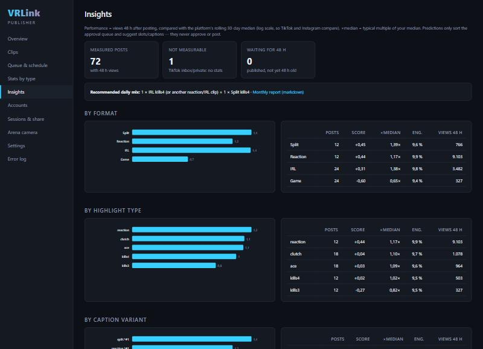
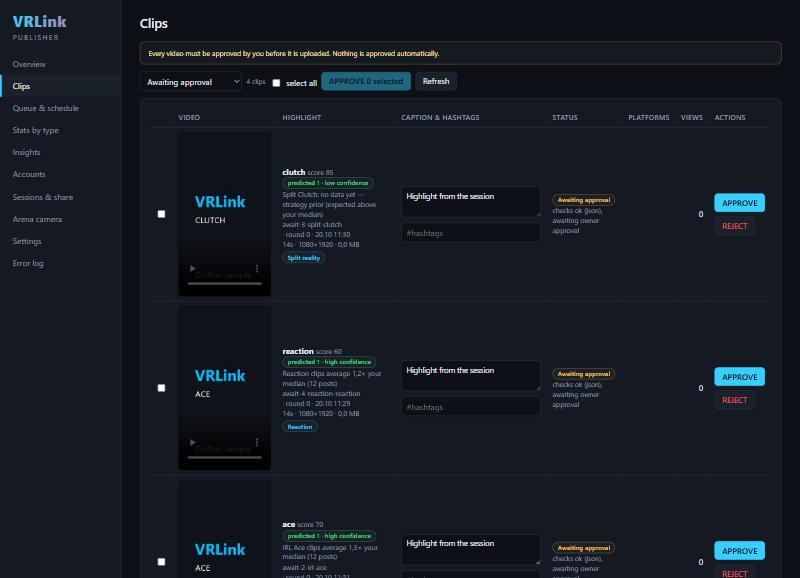

# V5: Learning loop and posting rhythm (Publisher)

**Ground rule:** predictions only **sort and recommend**. They never approve, never schedule an unapproved clip and never post. Every upload still needs Clemens' APPROVE click, and the approval and upload gates are unchanged.

| Insights | Approval queue sorted by prediction |
|---|---|
|  |  |

Both screenshots use synthetic data (`tests/Publisher.Tests/ScreenshotSeed.cs`, run with `VRLINK_SEED_DIR`). A sample report is in `v5/sample_monthly_report.md`.

## Metric (`Services/Learning.cs` → `Performance`)
- **Views at 48 h** are linearly interpolated from the StatsPoller series, with 0 views at publish time. Views at 7 days are also stored when available. **Engagement** = (likes+comments+shares+saves)/views.
- **Normalised score** per platform:
  - (log(1+views48h) − the platform's rolling 30-day median of log views) / robust spread (1.4826·MAD, ≥ 0.35);
  - when there are fewer than 3 posts in the window, all earlier posts are used;
  - 0 means typical for the account, so TikTok and Instagram become comparable.
- **Only measurable posts are learned from:** Instagram and TikTok direct posts with a post id and stats. **TikTok inbox/private posts have no stats and are excluded.** The Insights page shows them as "not measurable" and the report says so.

## Model (`PerformanceModel`)
- **Hierarchical normal-normal model** on the score:
  - (format, type) gets the **cold-start prior**: reaction ≥ irl > split > game, and Ace/Clutch > Kills4 > Kills3 > others;
  - → (format, type, platform);
  - → (format, type, platform, caption variant).
  - Each level uses its parent's posterior as its prior (partial pooling).
- **Caption variants:** Thompson sampling, plus a 20 % uniform exploration share (Settings).
- **Approval queue** (Clips page, "Awaiting approval"):
  - sorted by predicted score, then detector score;
  - badge "predicted ↑/→/↓ · high/medium/low confidence";
  - reason line, e.g. "IRL Ace clips average 2.3× your median (12 posts)", or "no data yet — strategy prior".
  - `ApprovalRanking.Sort` is read-only.

## Posting rhythm
- **Learned hours (`SlotLearning`):**
  - smoothed mean score per local hour, with circular Gaussian smoothing (σ 1.5 h) and a weak prior;
  - the two best hours ≥ 4 h apart, only between 07:00 and 23:00 and only where there is own data nearby;
  - before **10 measured posts** per platform the configured slots stay in charge.
- **Defaults** (new installs): TikTok 12:00 + 19:00, Instagram 11:30 + 20:00.
- **Settings → Posting hours:** automatic (learned once ≥ 10 posts) or always the configured slots. The scheduler keeps "never two same types in a row" and the approval requirement.
- **Queue page:**
  - **recommended daily mix**, e.g. "1 × Reaction (or another reaction/IRL clip) + 1 × Split kills4". It is ranked conservatively (mean − ½ sd), so tested combinations beat untested ones;
  - which slots are active (learned from n posts, or defaults).

## Captions
- Hook-first A/B templates per `format.type`, `format.*`, `type` or `*`. They are editable in Settings (one line per variant, as `key: text`).
- The variant id (e.g. `irl.ace#1`) is stored per post (`PlatformPost.CaptionVariant`, migration `Learning`) and evaluated in the same model.
- Clemens still edits the caption text at approval; the template wraps it.
- Note: existing installations keep their saved templates. The new hook-first defaults appear for new installs, or after editing them in.

## Insights page + monthly report
- `/insights`: cards (measured / not measurable / waiting for 48 h), plus SVG bars (×median) and tables by format, type, caption variant and posting hour.
- `/insights/report.md`: a markdown export with the same tables (last 30 days), the recommended mix, and **suggested detector weights** for the Unity HighlightRules as a JSON snippet.
  - Weights are exp(shrunk mean log-ratio) per type, clamped 0.5–2, Kills3 = 1.0; types without data stay 1.0.
  - Applying them is a separate manual PO step; nothing in `C:\vr\VRCsGo` is touched.

## Proof (tests `tests/Publisher.Tests/LearningTests.cs`)
- 48 h interpolation, engagement, series too short → null.
- Inbox/private posts excluded.
- TikTok (7× views) and Instagram give the same IRL-vs-game advantage after normalisation.
- Cold start follows the priors.
- The model converges to the true best arm against the prior (split Kills3 ranks first, "↑ high confidence").
- Thompson sampling picks the best caption variant 70–95 % of the late rounds while still exploring.
- Slot learning:
  - defaults below 10 posts; best hours learned after that;
  - circular smoothing wraps 23 ↔ 01;
  - the scheduler uses the learned 21:00 slot, keeps alternation, stores the caption variant, and can be switched off.
- **Sorting never changes approval state:** statuses and ApprovedAtUtc are unchanged, no posts are created, nothing is published.
- The monthly report contains the tables, the inbox note and the detector-weights JSON.
- The migration test still passes: the model matches the migrations.
